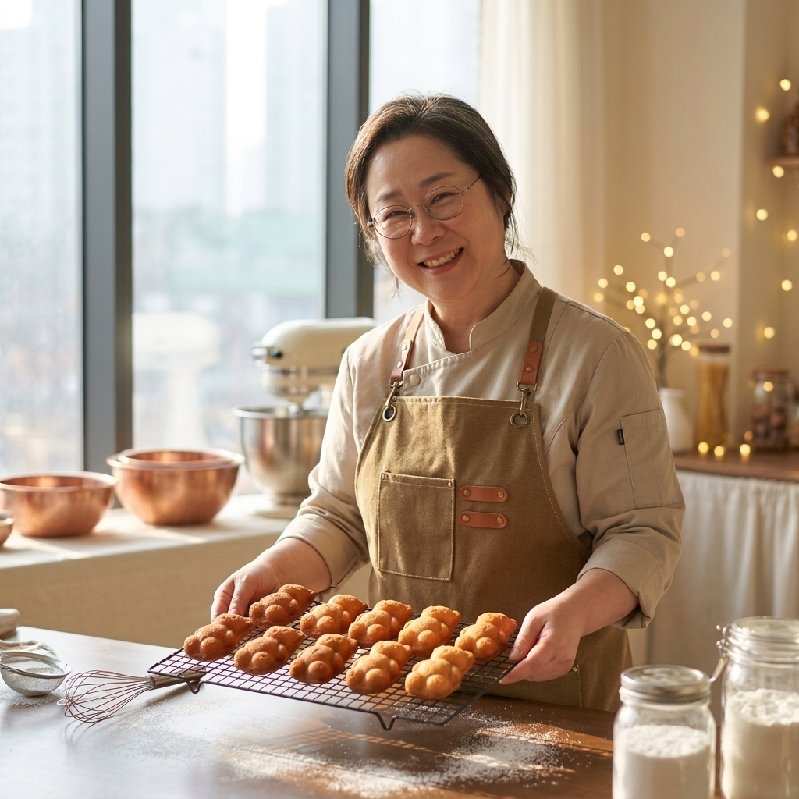
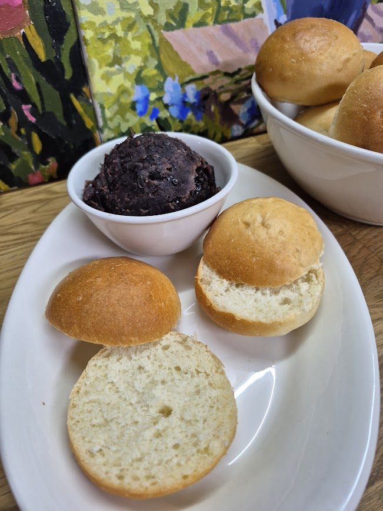
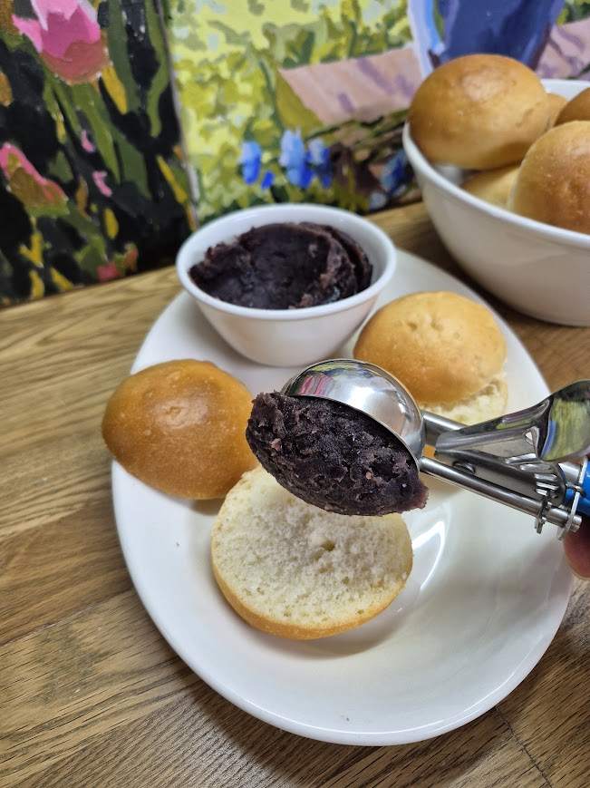
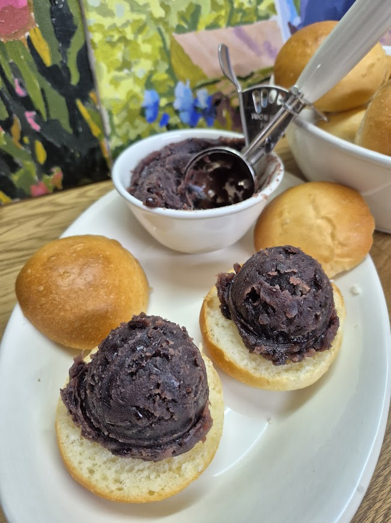
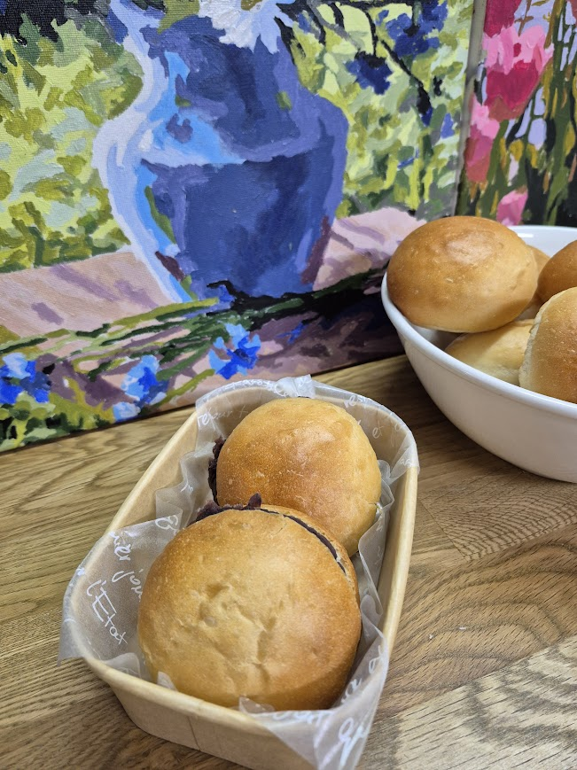

# PPTX Extraction: 오픈단팥빵_약수_v1.0 (강사 소개 통합본)

---

## Slide 1

강사 소개 한혜숙 요리와 베이킹을 좋아해서 30 년 야매 베이킹 인생에 마침표를 찍은 여자 라일락의 작업실 대표 제과제빵 소품 전문 제작 , 베이킹 강의 전문분야 제과제빵 , 천연 발효빵 , 케이크 디자인

---

## Slide 2

# 강사 이력 및 수상 경력

### 주요 강의 이력
- **2026**: 약수노인복지관 베이킹 수업, 산곡초 학부모 교육
- **2025**: 남한중 학부모 교육, 경영고 학부모 교육, 산곡초 학부모 교육
- **2024**: 감일초 학부모 교육, 서부초 학부모 교육, 서부초 출판의 날 기념 답례품, 산곡초 학부모 교육
- **2023**: 산곡초 학부모 교육

### 자격 및 전문 수료
- **2025**: 아동요리지도사 1급, 아동교육지도사 1급
- **2023**: 천연발효빵 마스터 자격 취득, 종로호텔제과직업전문학교 케이크디자인·천연발효빵 수료, 아동건강생활 코치 양성과정 수료
- **2022**: 퍼스트아카데미 제과제빵 수료, 제빵기능사 자격 취득

### 대표 활동 및 수상 이력 (라일락의 작업실)
- **2025**: 국회의원 표창장
- **2023**: 한벚재단 20년 지속 기부 감사장, 하남시장 감사장
- **2014**: 하남발도르프 숲골어린이집 대표
- **2010**: 아토피 환아용 찐빵
---

## Slide 4

모닝빵 가르기 직접 만든 폭신한 모닝빵을 반으로 갈라 뚜껑을 분리해 주세요

---

## Slide 5

단팥 앙금넣기 반으로 가른 모닝빵에 단팥앙금을 듬뿍넣어주세요

---

## Slide 6

초코펜으로 장식하고 포장하기 초코펜으로 오픈 단팥빵 뚜껑에 그리고 싶은 그림을 그려주세요 종이 도시락에 유산지를 깔고 오픈 단팥빵을 넣어 주세요

