# PPTX Extraction: 고구마 크럼블 머핀_v1.0 (강사 소개 및 고구마 탐구 통합본)

---

## Slide 1

강사 소개 한혜숙 요리와 베이킹을 좋아해서 30년 야매 베이킹 인생에 마침표를 찍은 여자 라일락의 작업실 대표 제과제빵 소품 전문 제작, 베이킹 강의 전문분야 제과제빵, 천연 발효빵, 케이크 디자인

---

## Slide 2

# 강사 이력 및 수상 경력

### 주요 강의 이력
- **2026**: 약수노인복지관 베이킹 수업, 산곡초 학부모 교육
- **2025**: 남한중 학부모 교육, 경영고 학부모 교육, 산곡초 학부모 교육
- **2024**: 감일초 학부모 교육, 서부초 학부모 교육, 서부초 출판의 날 기념 답례품, 산곡초 학부모 교육
- **2023**: 산곡초 학부모 교육

### 자격 및 전문 수료
- **2025**: 아동요리지도사 1급, 아동교육지도사 1급
- **2023**: 천연발효빵 마스터 자격 취득, 종로호텔제과직업전문학교 케이크디자인·천연발효빵 수료, 아동건강생활 코치 양성과정 수료
- **2022**: 퍼스트아카데미 제과제빵 수료, 제빵기능사 자격 취득

### 대표 활동 및 수상 이력 (라일락의 작업실)
- **2025**: 국회의원 표창장
- **2023**: 한벚재단 20년 지속 기부 감사장, 하남시장 감사장
- **2014**: 하남발도르프 숲골어린이집 대표
- **2010**: 아토피 환아용 찐빵

---

## Slide 3

고구마 크럼블 머핀 소개
달콤 포근한 수제 머핀: 달콤하고 부드러운 찐고구마와 바삭 고소한 소보로 크럼블이 입안 가득 환상적으로 어우러지는 영양 만점 머핀입니다.
오늘의 베이킹: 우유버터, 비정제 원당, 무항생제 달걀, 유기농 밀가루에 찐고구마를 듬뿍 넣어, 겉은 바삭하고 속은 촉촉·포근한 고구마 크럼블 머핀을 만들어 볼게요!

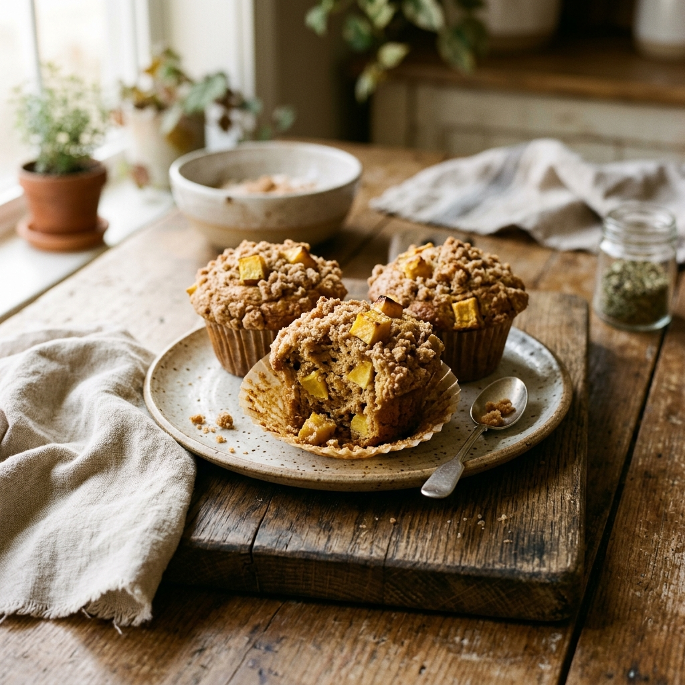

---

## Slide 4

[역사 탐구] 고구마에 대해 알기 (유럽 및 아시아 도입)
고구마는 중앙 및 남아메리카 열대 지역이 원산지입니다. 1500년대에 콜럼버스가 신대륙을 탐험하면서 유럽에 처음 소개했고, 1580년대에는 스페인의 무역 항로를 따라 필리핀 등 아시아 지역에 전파되었습니다. 이후 일본을 거쳐 1700년대(1763년) 조선통신사 조엄에 의해 한국에 최초 도입되었으며, 18세기부터 척박한 땅에서도 잘 자라는 대표적인 구황작물로 전국에 널리 재배되기 시작했습니다.

---

## Slide 5

[식재료 탐구] 영양 만점 고구마의 비밀
고구마는 메꽃과의 여러해살이 뿌리채소로 먹는 부분이 덩이뿌리입니다. (감자는 줄기, 고구마는 뿌리!) 고구마를 자르면 나오는 하얀 진액인 '얄라핀(Jalapin)' 성분은 장 운동을 활발하게 촉진하고 소화를 돕습니다. 또한 풍부한 식이섬유, 비타민 C, 칼륨 등이 함유되어 면역력과 건강에 매우 유익한 슈퍼푸드입니다.

---

## Slide 6

준비물
우유버터, 비정제 원당, 무항생제 달걀, 유기농 박력분, 소금, 베이킹 파우더, 베이킹 소다, 찐고구마, 소보로 (크럼블)

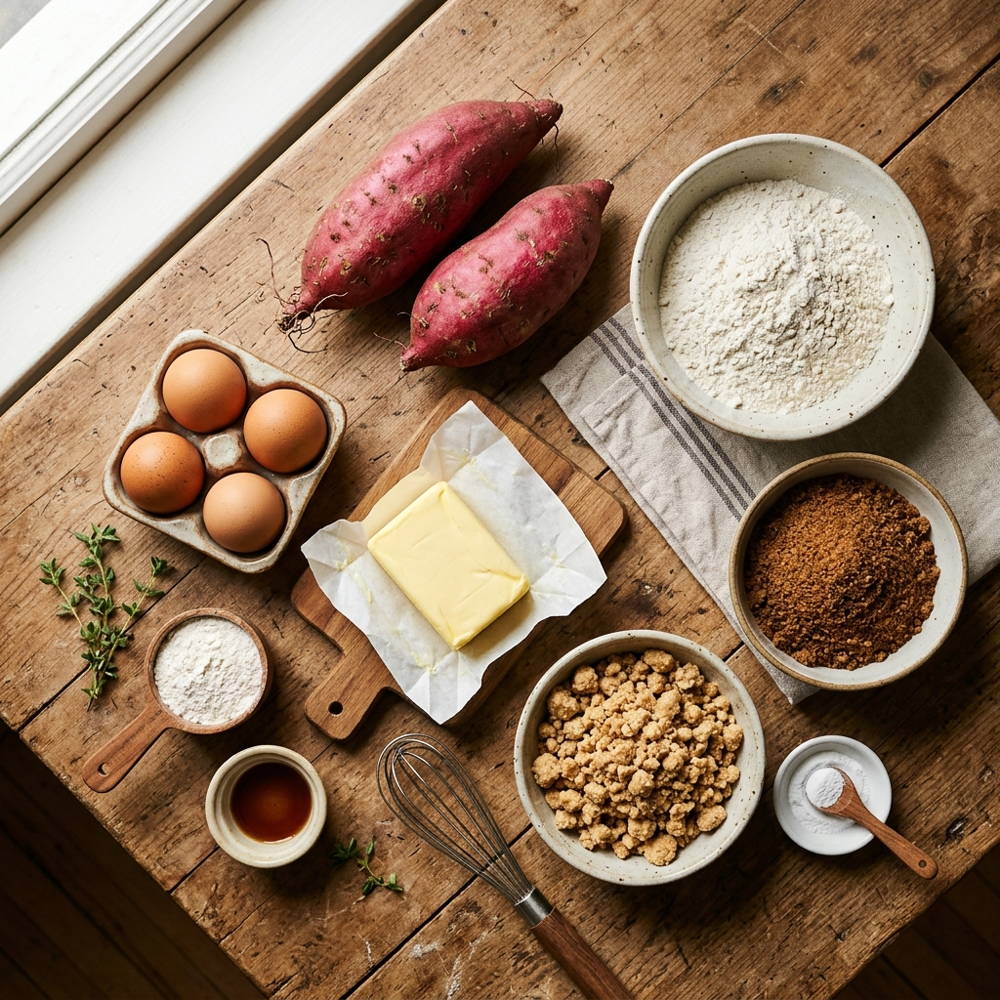

---

## Slide 7

[1단계] 고구마 쪄서 작게 잘라 준비 신선한 고구마를 깨끗이 씻어 찜기에 쪄낸 뒤, 머핀에 쏙 들어가도록 도마 위에서 약 1cm 크기로 작고 고르게 깍둑썰기하여 준비합니다.

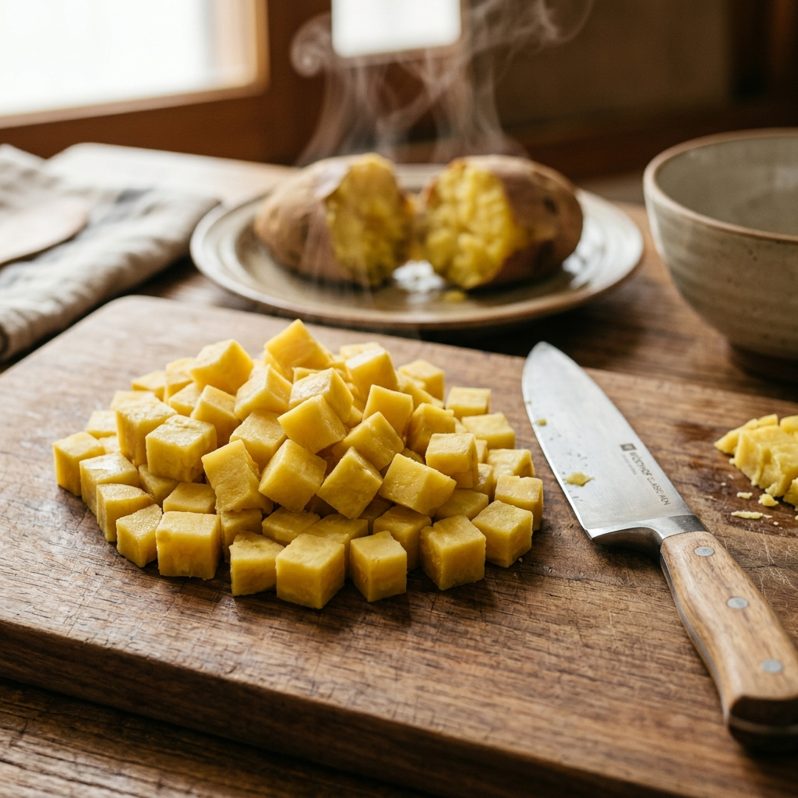

---

## Slide 8

[2단계] 가루류 체치기 박력분, 소금, 베이킹 파우더, 베이킹 소다를 함께 체에 쳐서 뭉침 없이 곱게 준비합니다.

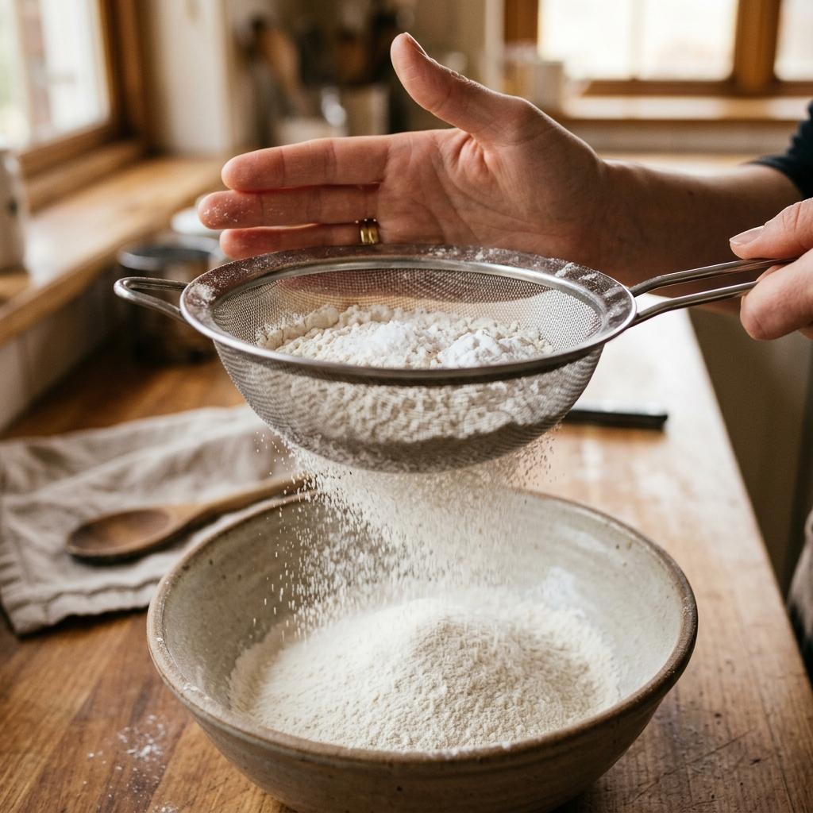

---

## Slide 9

[3단계] 실온 버터 크림화하기 실온 상태의 부드러운 버터를 볼에 넣고 가볍게 푼 뒤, 비정제 원당을 넣고 서걱거림이 줄어들 때까지 충분히 크림화합니다.

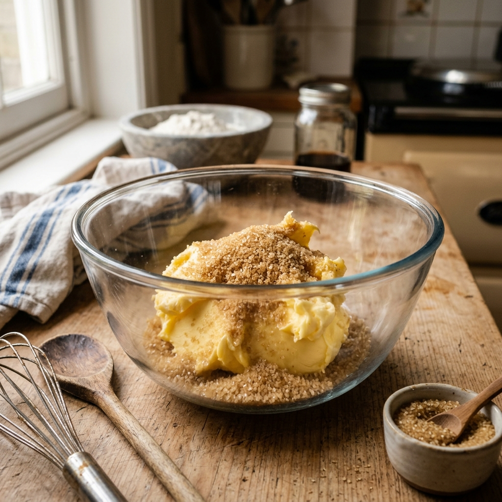

---

## Slide 10

[4단계] 달걀 넣고 섞기 크림화한 버터에 실온 온도의 무항생제 달걀을 2~3회에 걸쳐 조금씩 나누어 넣으며 분리되지 않도록 빠르게 휘핑합니다.

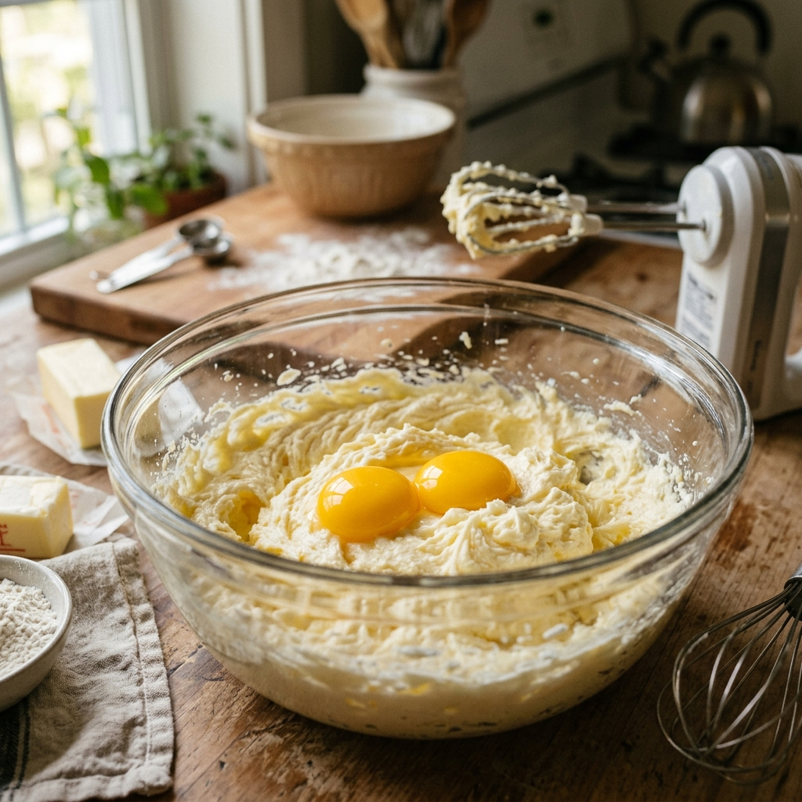

---

## Slide 11

[5단계] 체친 가루류 넣어 섞기 체에 쳐둔 가루류를 넣고 고무주걱의 날을 세워 '11' 자를 그리며 자르듯이 가볍게 섞어 글루텐 형성을 방지합니다.

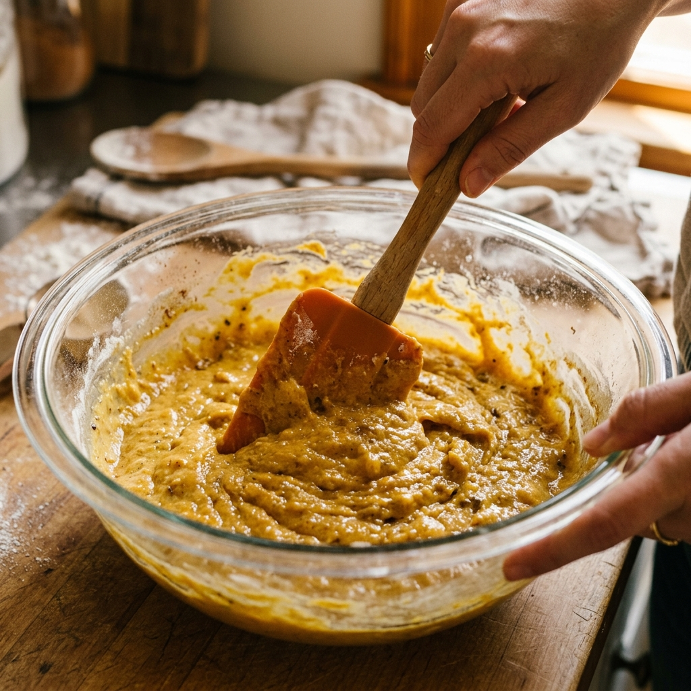

---

## Slide 12

[6단계] 찐고구마 넣어 섞기 미리 쪄서 작게 잘라둔 찐고구마를 반죽에 넣고, 고구마 조각 형태가 뭉개지지 않도록 주걱으로 살살 고르게 섞어줍니다.

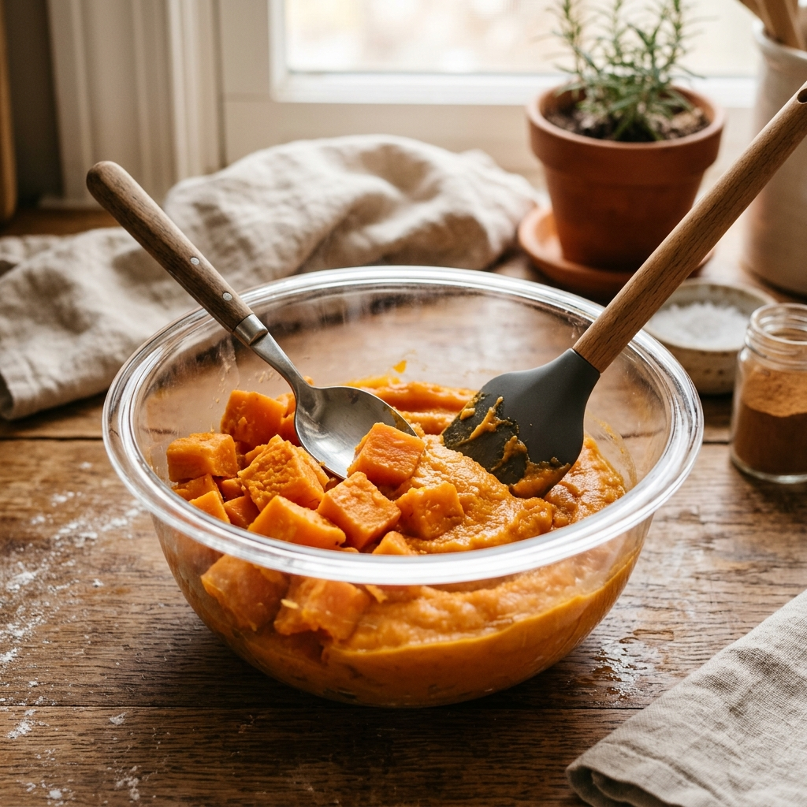

---

## Slide 13

[7단계] 80% 팬닝 및 크럼블 뿌리기 머핀팬에 유산지 컵을 깔고 반죽을 80% 높이까지만 채운 뒤, 고소한 소보로 크럼블을 윗면에 듬뿍 골고루 뿌려줍니다.

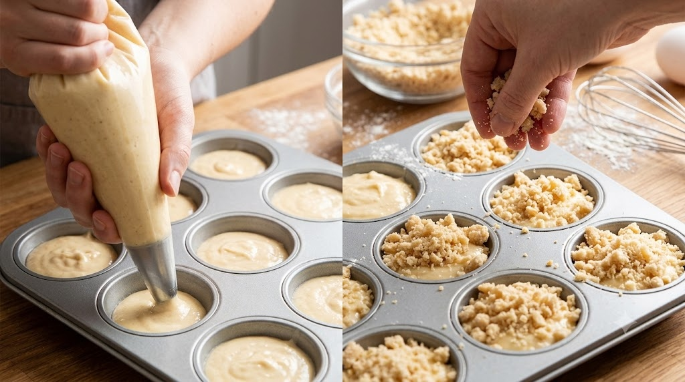

---

## Slide 14

[8단계] 오븐에 굽기 180도로 예열된 오븐에서 20~30분간 노릇노릇 고소하게 구워냅니다.

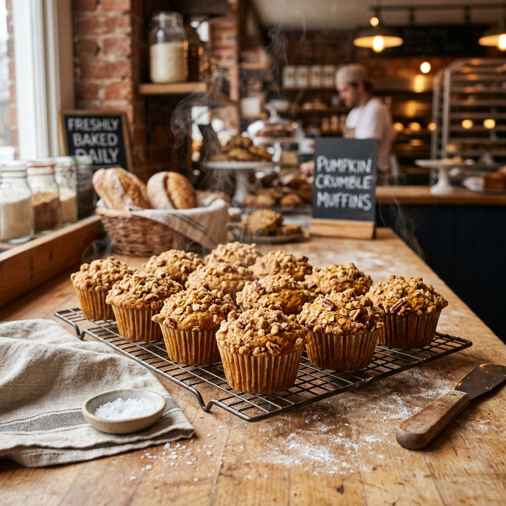

---

## Slide 15

[완성 & 원포인트 꿀팁] 노릇한 완성작 및 실패 없는 꿀팁 겉은 바삭하고 속은 촉촉하고 포근한 수제 고구마 크럼블 머핀 완성! 머핀 반죽을 너무 오래 치대면 글루텐이 과하게 생겨 질겨지므로 날가루가 안 보일 정도로만 가볍게 섞는 것이 부드러운 식감의 비결입니다. 또한 오븐에서 꺼낸 후 식힘망에서 완전히 식혀 포장해야 수증기가 맺혀 크럼블이 눅눅해지고 빵이 질겨지는 것을 막을 수 있습니다.

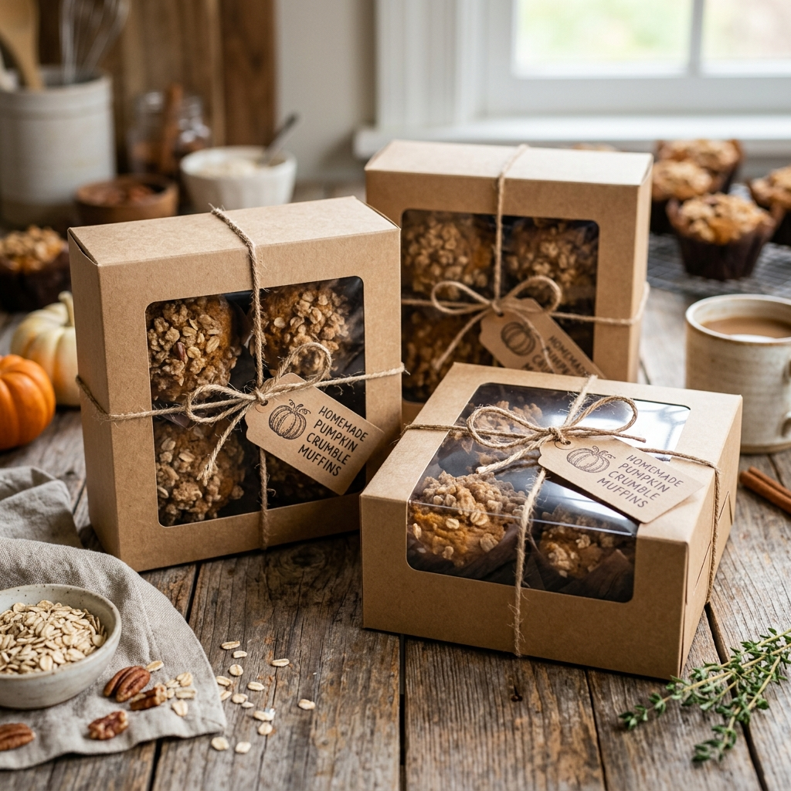

---

## Slide 16

[Special Session] 꼭 확인해야 할 빵 성분 (섹션 안내)
오늘 맛있는 고구마 크럼블 머핀을 완성해 보셨는데요, 수업을 마무리하기 전 여러분을 위해 아주 특별한 추가 교육 세션을 준비했습니다. 바로 "우리가 매일 먹는 빵, 과연 어떤 재료로 만들어졌을까요?"입니다. 시중에서 손쉽게 사 먹는 유명 브랜드 빵들의 화려한 겉포장 뒤에 숨겨진 실제 원재료명 라벨을 직접 분석해 보고, 나와 내 가족의 건강을 위해 빵을 고를 때 꼭 확인해야 할 핵심 기준을 함께 살펴보겠습니다.

---

## Slide 17

[성분 분석 ①] 파리바게뜨 호두파운드 성분표 실체
우리가 마트나 베이커리에서 흔히 보는 파리바게뜨 호두파운드케이크 라벨입니다. 겉포장에는 '호두의 영양을 듬뿍 담아 건강하게 굽습니다'라고 적혀 있지만, 실제 성분표를 보면 순수 우유버터는 단 1%도 들어있지 않고 저렴한 식물성 기름을 굳힌 가공버터와 마가린, 쇼트닝이 기본 유지로 사용됩니다. 또한 글리세린지방산에스테르 등 화학 유화제와 인공 합성향료(호두향)로 맛과 질감을 인위적으로 유지하고 있습니다.

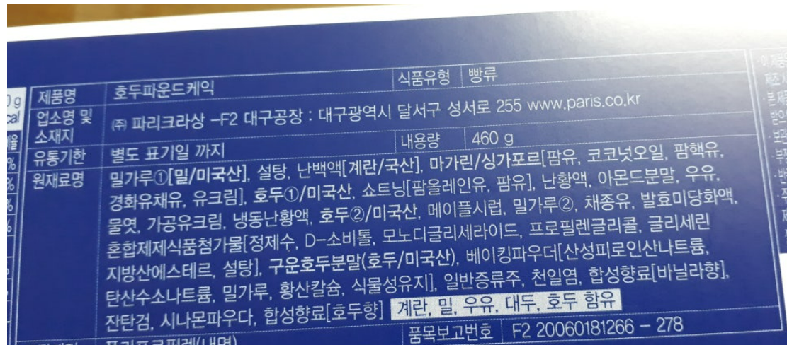

---

## Slide 18

[성분 분석 ②] 뚜레쥬르 호두파운드 성분표 실체
다음은 뚜레쥬르의 선물용 호두파운드케이크입니다. 고급스러운 패키지 뒷면의 원재료명을 확인해 보면 말레이시아산 팜유와 인도네시아산 야자경화유로 만든 마가린을 사용하고 있으며, 쇼트닝 1과 쇼트닝 2를 함께 혼합하여 부드러움을 인위적으로 만들었습니다. 여기에 산성피로인산나트륨, 제일인산칼슘 등 인산염계 화학 팽창제까지 다수 첨가되어 있습니다.

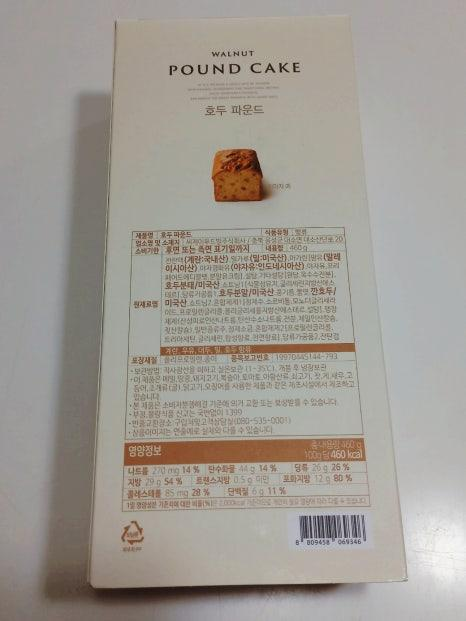

---

## Slide 19

[성분 분석 ③] 코스트코 시나몬 피칸 케이크 성분표 실체
코스트코의 시나몬 피칸 케이크는 국산 '동물복지란'을 12% 사용했다고 전면에 크게 내세우고 있습니다. 하지만 정작 성분표를 보면 신선한 밀가루 대신 장기 보관용 수입 가공 케익믹스를 베이스로 하고 있으며, 특히 100g당 당류가 무려 37g으로 1일 권장 기준치의 37%에 달합니다. 빵 한두 조각만 먹어도 하루 설탕 섭취 한도를 훌쩍 넘길 수 있으므로 영양성분표 확인이 필수적입니다.

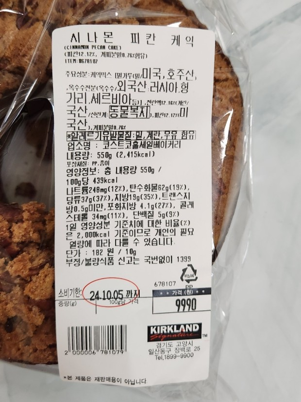

---

## Slide 20

[성분 가이드] 꼭 확인해야 할 빵 성분 4가지 (체크리스트)
빵을 살 때 뒷면 라벨에서 꼭 확인해야 할 핵심 4가지 체크리스트입니다. 첫째, 가공버터·마가린·쇼트닝 대신 '100% 우유버터'를 확인하세요. 둘째, 정제백설탕과 액상과당 대신 '비정제 원당'을 선택하세요. 셋째, 화학 유화제 대신 달걀 노른자로 자연 유화된 빵을 고르세요. 넷째, 인공 합성향료 대신 진짜 자연 원물이 들어간 빵을 선택하세요. 오늘 우리가 함께 만든 고구마 크럼블 머핀은 이 모든 좋은 재료를 정직하게 담아 만든 가장 안전하고 건강한 빵입니다.

